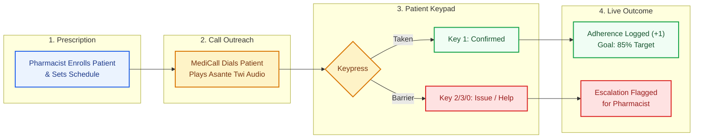
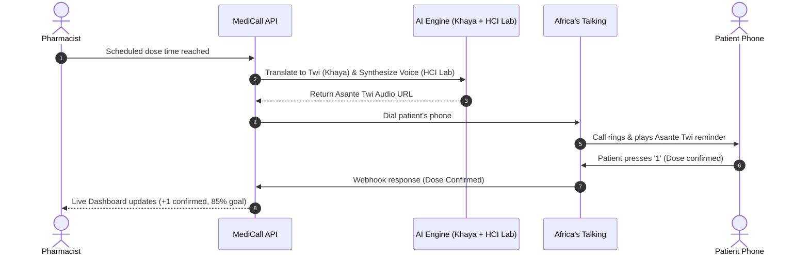
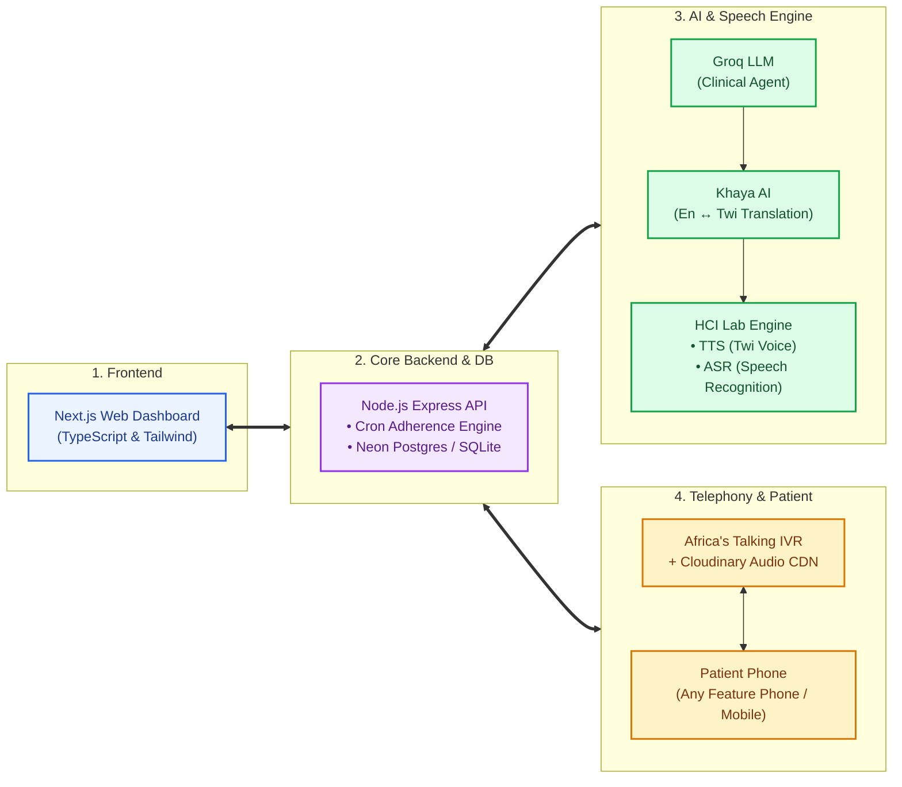

# MediCall Presentation Diagrams (Slide-Ready)

These diagrams are minimal, clear, and horizontal, designed to fit cleanly on standard 16:9 PowerPoint presentation slides without emojis or visual clutter.

---

## Slide 1: User Flowchart

### Presentation Talking Points
* **Prescription:** Pharmacist registers patient details, medication regimen, and language preference (Asante Twi / English).
* **Automated Voice Check:** The system calls automatically at the patient's exact scheduled time.
* **Accessible Keypad:** Patients do not need literacy skills; they listen in Asante Twi and press 1 to confirm.
* **Closed-Loop Action:** Confirmations update adherence statistics; reported side effects or cost issues alert the pharmacist for follow-up.

---

## Slide 2: Sequence Diagram (Call Lifecycle)

### Presentation Talking Points
* **Zero Latency:** Pre-generated audio and cached templates allow immediate phone playback.
* **Localization Pipeline:** Khaya AI translates English clinical guidance to natural Asante Twi, and HCI Lab synthesizes native-sounding speech.
* **Instant Feedback:** DTMF keypress 1 is instantly captured by Africa's Talking and reflected on the clinic dashboard.

---

## Slide 3: System Architecture

### Presentation Talking Points
* **Layer 1 (Frontend):** Modern web dashboard built in Next.js for Ghanaian pharmacists.
* **Layer 2 (Core Backend):** Express server and Neon PostgreSQL orchestrating adherence tracking, retries, and offline SQLite resilience.
* **Layer 3 (AI & Speech):** Groq personalizes the clinical context, Khaya AI handles English-to-Twi translation, and HCI Lab powers both Asante Twi Text-to-Speech (TTS) and voice recognition (ASR).
* **Layer 4 (Telephony):** Africa's Talking connects directly over standard cellular voice networks (MTN, Telecel, AT) to reach any basic phone without internet.
