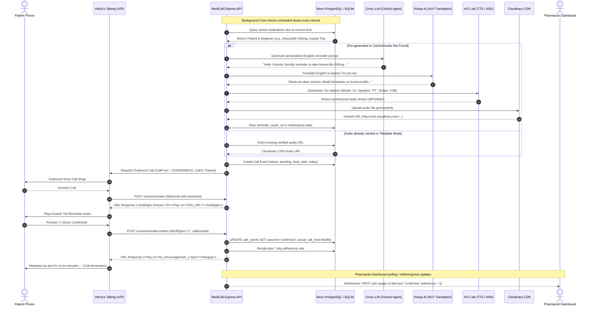
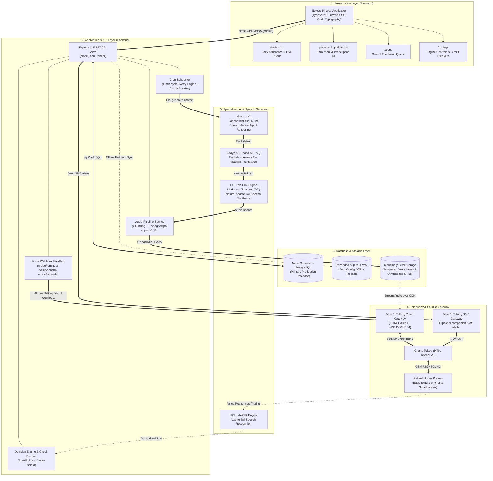

# MediCall Technical Deep-Dive: Engineering Diagrams & Specifications

This document contains the detailed technical blueprints, full-sequence execution flows, and architectural specifications for the MediCall platform.

---

## 1. Detailed Multi-Service Sequence Diagram

This diagram details every step across all internal microservices and external gateways, including:
- Cron schedule matching
- Groq prompt personalization
- Khaya AI machine translation
- HCI Lab TTS synthesis and audio chunking
- Cloudinary permanent caching
- Africa's Talking XML webhook handshake
- DTMF keypress capture and real-time adherence recalculation

---

## 2. Comprehensive 5-Tier System Architecture Blueprint

---

## 3. Component Responsibility Matrix

| Component | Technology | Primary Role |
|---|---|---|
| **Frontend UI** | Next.js 15, TypeScript, Tailwind | Pharmacist workspace: enrollment, medication prescription, adherence tracking, alert resolution. |
| **API Backend** | Node.js, Express | Business logic, cron schedule evaluation, Africa's Talking IVR XML generation, circuit breaking. |
| **Database** | Neon PostgreSQL (primary) + SQLite (fallback) | Storage of patient records, active medication regimens, call event audit trail, escalation logs. |
| **Telephony Gateway** | Africa's Talking Voice API | Placing outbound voice calls from `+233308048104`, DTMF keypress parsing, call state webhooks. |
| **CDN Media Storage** | Cloudinary | Permanent storage and ultra-low latency streaming of pre-recorded and synthesized MP3 audio. |
| **Clinical Agent Reasoning** | Groq (`openai/gpt-oss-120b`) | Formulating empathetic reminder prompts and diagnosing medication adherence barriers. |
| **Translation Engine** | Khaya AI (Ghana NLP) | High-accuracy English $\leftrightarrow$ Asante Twi translation. |
| **TTS Speech Synthesis** | HCI Lab (Lab Subscription Platform) | Synthesizing Asante Twi neural speech with speaker `PT`, audio chunking, and speed tempo control (0.88x). |
| **ASR Voice Recognition** | HCI Lab ASR Platform | Transcribing spoken patient voice notes in Asante Twi into text for clinical evaluation. |
